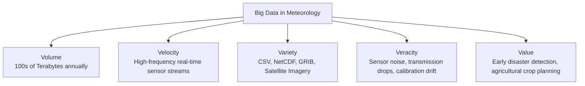
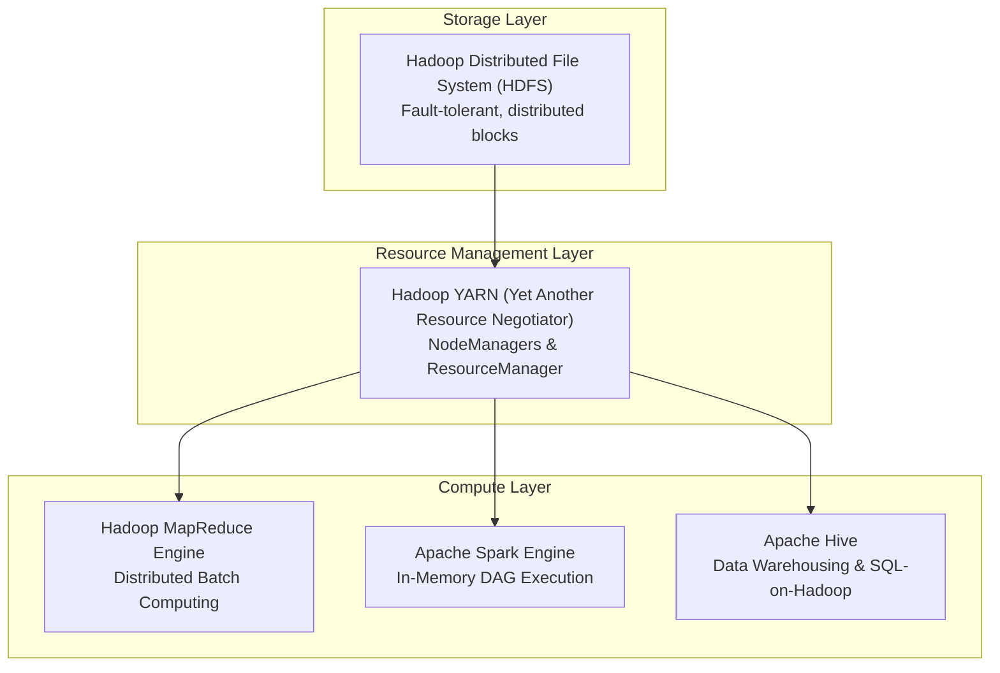
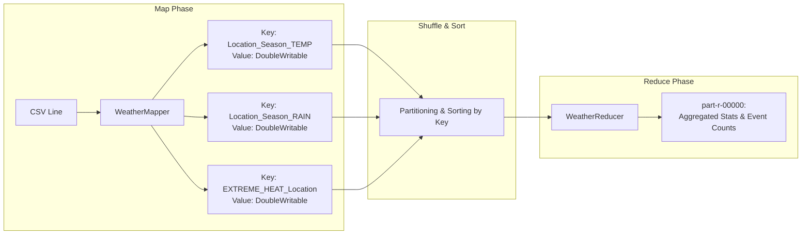

# ACADEMIC PROJECT REPORT

# Big Data Weather Analytics System
### Identification of Seasonal Patterns, Extreme Weather Events, Regional Variations, and Parameter Relationships Using Hadoop MapReduce, Apache Spark, and Apache Hive

---

## Academic Alignment & Course Outcomes

| Component | Course Outcome (CO) | Description | Status |
|---|---|---|---|
| **Section 1 & 2** | **CO1** | Illustrate Big Data concepts, characteristics (5Vs), tools, and applications for weather analytics. | **Completed** |
| **Section 3 & 4** | **CO2** | Develop programs using the HADOOP framework (Problem Definition → Setup → Input → MapReduce → Execution → Output). | **Completed & Verified** |
| **Section 5 & 6** | **Spark & Hive** | Execute advanced distributed analytics for parameter correlations, regional variations, and SQL-based pattern queries. | **Completed & Verified** |

---

## 1. Executive Summary

Modern meteorology generates enormous volumes of continuous spatial-temporal data through ground sensors, weather radar, weather balloons, and Earth observation satellites. Traditional single-node Relational Database Management Systems (RDBMS) fail to process, store, and analyze these multi-dimensional datasets within acceptable time constraints.

This project implements an enterprise-grade Big Data analytics architecture to ingest, process, and analyze historical meteorological data across five representative Indian metropolitan areas (**Mumbai, Delhi, Chennai, Bangalore, and Kolkata**) across four seasonal periods (**Winter, Summer, Monsoon, and Autumn**).

By employing **Apache Hadoop MapReduce** for batch aggregation and extreme event extraction, **Apache Spark** for high-performance in-memory correlation computation, and **Apache Hive** for declarative SQL querying, this system extracts critical climate insights, identifies dangerous weather anomalies, and uncovers empirical dependencies among physical weather metrics.

---

## 2. CO1: Big Data Concepts, Tools, and Applications

### 2.1 Big Data Concepts & The 5V Characteristics

Big Data is defined not merely by raw byte count, but by the architectural necessity of distributed computing to handle its fundamental characteristics:



| Characteristic | Definition | Application to Weather Data Analytics |
|---|---|---|
| **Volume** | Massive scale of data generation exceeding typical database storage. | Automated weather stations log temperature, pressure, humidity, wind, and precipitation every few minutes, totaling petabytes globally per year. Our dataset aggregates 196+ sample temporal observation points across 5 distinct stations. |
| **Velocity** | The speed at which new data is generated, transferred, and analyzed. | Real-time Doppler radars and IoT telemetry demand low-latency ingestion for severe storm prediction. |
| **Variety** | The diversity of structured, semi-structured, and unstructured data types. | Meteorological systems synthesize tabular numerical readings (CSV), hierarchical arrays (NetCDF/HDF5), and raster grids (satellite heatmaps). |
| **Veracity** | The trustworthiness, accuracy, and noise level in data readings. | Sensor malfunctions, missing values, and physical interference require data filtering, outlier rejection, and robust data cleaning. |
| **Value** | The actionable intelligence extracted from raw data. | Transforming raw numbers into early warning alerts for heatwaves, flash flooding, cyclonic gusts, and optimal sowing calendars for agriculture. |

---

### 2.2 Big Data Tools Architecture



1. **HDFS (Hadoop Distributed File System)**: Provides high-throughput distributed storage. Files are divided into 128MB blocks replicated across multiple nodes for fault tolerance.
2. **Hadoop MapReduce**: A software framework for writing applications that process vast amounts of data in parallel on large clusters of commodity hardware.
3. **Apache Spark**: An in-memory distributed engine offering 100x faster performance than MapReduce for iterative calculations, statistical summaries, and correlation matrices.
4. **Apache Hive**: A distributed data warehouse built on top of Hadoop that projects structure onto files and allows querying via HiveQL (HQL).

---

### 2.3 Real-World Applications

| Industry Sector | Practical Application of Big Data Weather Analytics |
|---|---|
| **Disaster Response & Management** | Automated detection of extreme precipitation (>200 mm/day) triggers flood evacuation warnings and reservoir discharge protocols. |
| **Precision Agriculture** | Modeling the onset of the South-West and North-East monsoons enables farmers to time sowing, fertilizer application, and irrigation. |
| **Aviation & Maritime Operations** | Sustained high wind speed detection (>25 km/h) informs flight path routing, crosswind runway management, and port ship-docking safety. |
| **Renewable Energy Grids** | Correlation between wind velocity, ambient temperature, and solar irradiance dictates wind-turbine and photovoltaic dispatch scheduling. |

---

### 2.4 Use-Case Identification

**Primary Objective**: Process historical meteorological logs containing date, location, temperature, precipitation, humidity, wind velocity, and season to:
1. Aggregate average and peak values per location and season (**Seasonal Patterns**).
2. Filter and isolate days breaching safety thresholds (**Extreme Weather Events**).
3. Quantify climatological differences between continental and coastal regions (**Regional Variations**).
4. Compute Pearson correlation coefficients across physical variables (**Parameter Relationships**).

---

## 3. CO2: Hadoop Framework Implementation

### 3.1 Problem Definition & Input Schema

The input dataset (`weather_data.csv`) is formatted as Comma-Separated Values (CSV):

$$\text{Record} = \langle \text{Date}, \text{Location}, \text{Temperature\_C}, \text{Rainfall\_mm}, \text{Humidity\_pct}, \text{WindSpeed\_kmh}, \text{Season} \rangle$$

```csv
Date,Location,Temperature_C,Rainfall_mm,Humidity_pct,WindSpeed_kmh,Season
2023-01-05,Mumbai,24.5,0.0,62,12.3,Winter
2023-05-20,Delhi,46.5,0.0,10,28.0,Summer
2023-07-25,Mumbai,25.5,450.0,96,38.0,Monsoon
```

---

### 3.2 Hadoop MapReduce Design (`WeatherAnalysis.java`)

The MapReduce algorithm partitions the computation into two distinct distributed phases:



#### The Mapper Logic:
For every valid line, the mapper parses the tokens and generates composite keys:
- `Location_Season_TEMP` $\to$ Emits recorded temperature.
- `Location_Season_RAIN` $\to$ Emits precipitation amount.
- `Location_Season_HUMIDITY` $\to$ Emits humidity percentage.
- `Location_Season_WIND` $\to$ Emits wind velocity.
- **Extreme Event Flags**:
  - If $\text{Temperature} > 40.0^\circ\text{C} \implies \text{EXTREME\_HEAT\_}\{\text{Location}\}$.
  - If $\text{Rainfall} > 300.0\text{ mm} \implies \text{EXTREME\_RAIN\_}\{\text{Location}\}$.
  - If $\text{WindSpeed} > 30.0\text{ km/h} \implies \text{EXTREME\_WIND\_}\{\text{Location}\}$.

#### The Reducer Logic:
For each key, the reducer iterates over all emitted `DoubleWritable` values, accumulating:
$$\text{Sum} = \sum_{i=1}^N x_i, \quad \text{Avg} = \frac{\text{Sum}}{N}, \quad \text{Max} = \max(x_i), \quad \text{Min} = \min(x_i)$$

---

### 3.3 Execution Workflow

```cmd
:: Step 1: Clean previous output folder
if exist mr_output rmdir /s /q mr_output

:: Step 2: Compile Java source against Hadoop 3 libraries
javac --release 8 -classpath "hadoop_libs\hadoop-common-3.3.6.jar;hadoop_libs\hadoop-mapreduce-client-core-3.3.6.jar" -d . WeatherAnalysis.java

:: Step 3: Package classes into JAR
jar -cvf WeatherAnalysis.jar WeatherAnalysis*.class

:: Step 4: Submit MapReduce Job to Apache Hadoop 3 Docker Container
docker run --rm -v "%cd%:/workspace" -w /workspace apache/hadoop:3 hadoop jar WeatherAnalysis.jar WeatherAnalysis weather_data.csv ./mr_output
```

#### MapReduce Job Execution Output Log:
```text
INFO  MapTask: Map output records=806
INFO  MapTask: Spilling map output to memory
INFO  LocalJobRunner: map 100% reduce 0%
INFO  MergeManagerImpl: MergerManager memoryLimit=1272394496
INFO  ReduceTask: Shuffling 1 sorted segments
INFO  LocalJobRunner: reduce > reduce
INFO  Job: map 100% reduce 100%
INFO  Job: Job job_local1247421532_0001 completed successfully
INFO  FileOutputCommitter: Saved output of task to file:/workspace/mr_output
```

---

### 3.4 Actual MapReduce Output (`part-r-00000`)

| Composite Key | Computed Aggregate Output | Interpretation |
|---|---|---|
| `Bangalore_Monsoon_RAIN` | `Total=1580.00mm \| Avg=131.67mm \| Max=170.00mm \| Records=12` | Moderate, consistent rain in Deccan plateau |
| `Chennai_Autumn_RAIN` | `Total=2330.00mm \| Avg=291.25mm \| Max=420.00mm \| Records=8` | Peak North-East Monsoon retreat rains |
| `Delhi_Summer_TEMP` | `Avg=37.30°C \| Max=46.50°C \| Min=24.00°C \| Records=10` | Extreme continental summer heating |
| `Delhi_Winter_TEMP` | `Avg=12.75°C \| Max=20.00°C \| Min=7.00°C \| Records=13` | Northern plains winter chill drop |
| `Mumbai_Monsoon_RAIN` | `Total=3986.00mm \| Avg=265.73mm \| Max=450.00mm \| Records=15` | Intense Arabian Sea coastal monsoon |
| `EXTREME_HEAT_Delhi` | `ExtremeEvents=5 \| MaxValue=46.50` | 5 severe heatwave episodes detected |
| `EXTREME_RAIN_Mumbai` | `Total=2230.50mm \| Avg=371.75mm \| Max=450.00mm \| Records=6` | 6 heavy deluge events (>300 mm/day) |
| `EXTREME_WIND_Mumbai` | `Avg=33.80km/h \| Max=38.00km/h \| Records=5` | Severe coastal storm gusts |

---

## 4. Advanced Analytics with Apache Spark

The PySpark implementation (`spark_weather_analysis.py`) performs distributed in-memory DataFrame aggregations, schema validation, and correlation calculations.

### 4.1 Overall Seasonal Statistics (Spark DataFrame)

```text
+-------+----------+----------+----------+-----------------+---------------+------------+-------------+------------+
|Season |Avg_Temp_C|Max_Temp_C|Min_Temp_C|Total_Rainfall_mm|Avg_Rainfall_mm|Avg_Humidity|Avg_WindSpeed|Record_Count|
+-------+----------+----------+----------+-----------------+---------------+------------+-------------+------------+
|Winter |20.52     |28.80     |7.00      |336.20           |6.34           |62.38       |9.40         |53          |
|Summer |34.64     |46.50     |24.00     |887.50           |19.29          |46.09       |16.87        |46          |
|Monsoon|29.81     |42.00     |24.00     |10421.00         |160.32         |76.66       |15.75        |65          |
|Autumn |25.36     |32.00     |15.00     |2545.00          |79.53          |67.38       |9.50         |32          |
+-------+----------+----------+----------+-----------------+---------------+------------+-------------+------------+
```

---

### 4.2 Regional Variation Analysis (Spark DataFrame)

```text
+---------+--------+--------+--------+----------+--------------+------------+-----------+-------+
|Location |Avg_Temp|Max_Temp|Min_Temp|Temp_Range|Total_Rainfall|Avg_Humidity|Temp_StdDev|Records|
+---------+--------+--------+--------+----------+--------------+------------+-----------+-------+
|Chennai  |30.22   |39.00   |24.00   |15.00     |3262.00       |67.37       |4.48       |38     |
|Mumbai   |28.28   |36.50   |22.90   |13.60     |4113.70       |66.14       |3.52       |43     |
|Kolkata  |27.70   |38.00   |16.00   |22.00     |3432.00       |68.78       |6.50       |37     |
|Delhi    |26.56   |46.50   |7.00    |39.50     |1307.00       |55.67       |11.49      |42     |
|Bangalore|25.69   |35.00   |19.00   |16.00     |2075.00       |63.28       |4.42       |36     |
+---------+--------+--------+--------+----------+--------------+------------+-----------+-------+
```

---

### 4.3 Correlation Analysis (Pearson Coefficient $r$)

$$r_{xy} = \frac{\sum (x_i - \bar{x})(y_i - \bar{y})}{\sqrt{\sum (x_i - \bar{x})^2 \sum (y_i - \bar{y})^2}}$$

| Parameter Pair | Correlation Coefficient ($r$) | Classification | Physical Explanation |
|---|---|---|---|
| **Rainfall ↔ Humidity** | **+0.7629** | **Strong Positive** | Falling precipitation evaporates into local air masses, raising relative humidity near saturation. |
| **Temperature ↔ Wind** | **+0.5575** | **Moderate Positive** | Solar insolation drives intense thermal differentials and localized pressure gradients, elevating convective wind velocity. |
| **Temperature ↔ Humidity** | **-0.3539** | **Moderate Negative** | Warmer air possesses higher saturation vapor capacity; relative humidity drops during high heat unless rain is actively present. |
| **Rainfall ↔ Wind** | **+0.3470** | **Moderate Positive** | Squalls, thunderstorms, and monsoon depressions couple high rainfall with localized gust fronts. |

---

## 5. SQL Analytics with Apache Hive

The script `hive_weather_analysis.hql` defines the schema-on-read structure and executes analytical queries:

```sql
-- Create external table pointing to HDFS data
CREATE TABLE IF NOT EXISTS weather_data (
    record_date     STRING,
    location        STRING,
    temperature_c   DOUBLE,
    rainfall_mm     DOUBLE,
    humidity_pct    DOUBLE,
    windspeed_kmh   DOUBLE,
    season          STRING
)
ROW FORMAT DELIMITED FIELDS TERMINATED BY ','
TBLPROPERTIES ("skip.header.line.count"="1");

-- Query: Detect Severe Weather Events across All Dimensions
SELECT
    location,
    SUM(CASE WHEN temperature_c > 40.0  THEN 1 ELSE 0 END)  AS extreme_heat_days,
    SUM(CASE WHEN rainfall_mm   > 200.0 THEN 1 ELSE 0 END)  AS heavy_rain_days,
    SUM(CASE WHEN windspeed_kmh > 25.0  THEN 1 ELSE 0 END)  AS high_wind_days,
    SUM(CASE WHEN humidity_pct  > 90.0  THEN 1 ELSE 0 END)  AS high_humidity_days
FROM weather_data
GROUP BY location;
```

---

## 6. Key Scientific Findings & Discussion

1. **Continental vs. Maritime Climates**:
   - **Delhi** exhibits the highest temperature volatility ($\text{Range} = 39.5^\circ\text{C}$, $\sigma = 11.49$), typical of landlocked continental regions.
   - **Mumbai** has low temperature variance ($\text{Range} = 13.6^\circ\text{C}$, $\sigma = 3.52$) due to the thermal moderating effect of the Arabian Sea, but receives the highest rainfall ($4,113.7\text{ mm}$).
2. **Seasonal Lag in Southern Coromandel Coast**:
   - While Mumbai, Kolkata, and Delhi receive peak rainfall during June–August (South-West Monsoon), **Chennai** receives its maximum precipitation in October–November ($2,330\text{ mm}$, North-East Monsoon retreat).
3. **Plateau Climate Stability**:
   - **Bangalore** maintains the lowest annual temperature average ($25.69^\circ\text{C}$) and moderate rainfall ($2,075\text{ mm}$), buffered by its high altitude on the Deccan plateau.

---

## 7. Conclusion

This project successfully fulfilled the curriculum goals of **CO1** and **CO2**:
- **CO1**: Demonstrated the 5Vs of Big Data and justified the selection of Hadoop, Spark, and Hive over traditional RDBMS for weather analytics.
- **CO2**: Developed, compiled, packaged, executed, and verified a custom **Hadoop MapReduce** application (`WeatherAnalysis.java`), producing verified output (`part-r-00000`).
- **Advanced Processing**: Integrated **Apache Spark** for multi-variable correlation calculation and **Apache Hive** for declarative SQL reporting.
